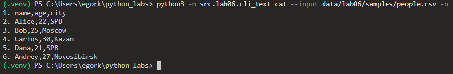
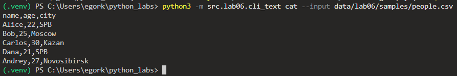
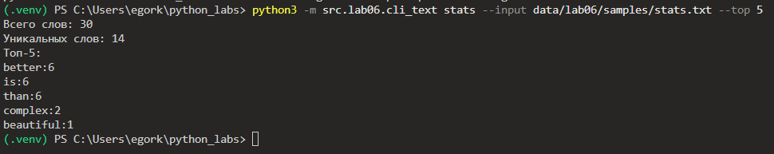
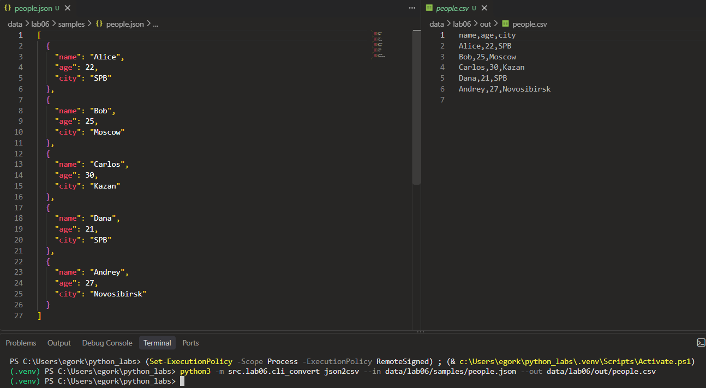
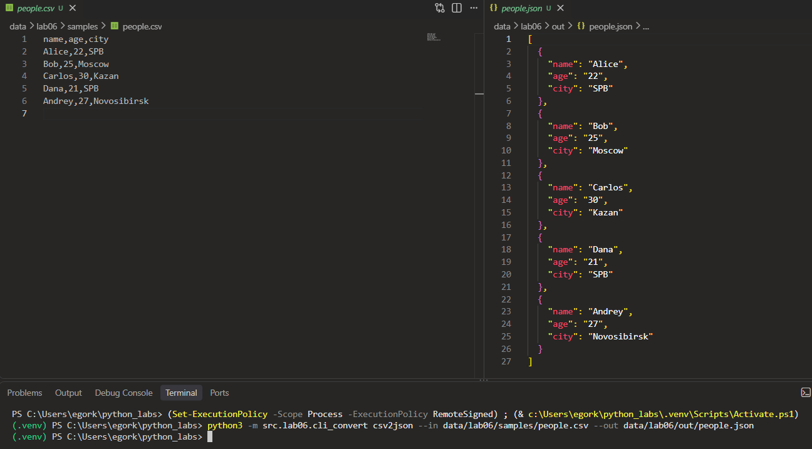
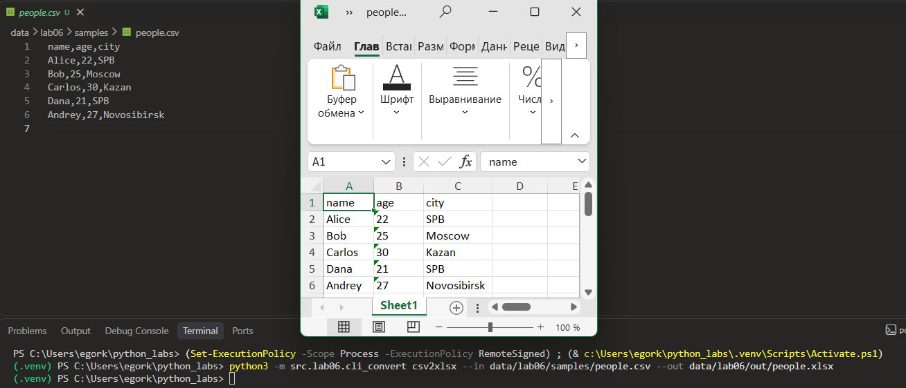

# ЛР6 — CLI‑утилиты с argparse (cat/grep‑lite + конвертеры): Техническое задание

---

## Модуль src/lab06/cli_text.py

---

### Функция **cat(input_path : str, n : bool) -> None**

Вызов функции через терминал:

```python
python3 -m src.lab06.cli_text cat --input data/lab06/samples/people.csv -n
```

```python
def cat(input_path : str, n : bool) -> None:
    """
    Подкоманда cat: выводит содержимое файла построчно.
    Если указан флаг -n - перед каждой строкой печатается её номер.
    """
    p = Path(input_path)
    lines = []

    try:
        with open(p, 'r', encoding='utf-8') as file:
            lines = file.readlines();
    except FileNotFoundError:
        print(f"Ошибка: файл не найден: {p}")
    except UnicodeDecodeError:
        print(f"Ошибка: не удалось прочитать файл {p} в кодировке UTF-8")

    for i in range(len(lines)):
        if n:
            print(f'{i + 1}. {lines[i]}', end='')
        else:
            print(lines[i], end='')
```

Флаг -n указан:



Флаг -n не указан:



---

### Функция **stats(input_path : str, top : int) -> None**

Вызов функции через терминал:

```python
python3 -m src.lab06.cli_text stats --input data/lab06/samples/stats.txt --top 5
```

```python
def stats(input_path : str, top : int) -> None:
    """
    Подкоманда stats: считает частоты слов в файле (функции из ЛР3)
    и печатает общее число слов, число уникальных слов и топ слов.
    """
    p = Path(input_path)
    try:
        with open(p, 'r', encoding='utf-8') as file:
            print(text_stats(file.read()))
    except FileNotFoundError:
            print(f"Ошибка: файл не найден: {p}")
    except UnicodeDecodeError:
        print(f"Ошибка: не удалось прочитать файл {p} в кодировке UTF-8")
```



---

## Модуль src/lab06/cli_convert.py

---

### Функция **main() -> None**

```python
def main() -> None:
    parser = argparse.ArgumentParser(description="Конвертеры данных JSON / CSV / XLSX")
    sub = parser.add_subparsers(dest="command", required=True)

    p1 = sub.add_parser("json2csv",help="преобразовать JSON в CSV",description="Преобразует JSON в CSV.")
    p1.add_argument("--in", dest="input", required=True, help="входной .json файл")
    p1.add_argument("--out", dest="output", required=True, help="выходной .csv файл")

    p2 = sub.add_parser("csv2json",help="преобразовать CSV в JSON",description="Преобразует CSV в JSON.")
    p2.add_argument("--in", dest="input", required=True, help="входной .csv файл")
    p2.add_argument("--out", dest="output", required=True, help="выходной .json файл")

    p3 = sub.add_parser("csv2xlsx",help="преобразовать CSV в XLSX",description="Преобразует CSV в файл Excel.")
    p3.add_argument("--in", dest="input", required=True, help="входной .csv файл")
    p3.add_argument("--out", dest="output", required=True, help="выходной .xlsx файл")

    args = parser.parse_args()

    try:
        if args.command == "json2csv":
            json_to_csv(args.input, args.output)
        elif args.command == "csv2json":
            csv_to_json(args.input, args.output)
        elif args.command == "csv2xlsx":
            csv_to_xlsx(args.input, args.output)
    except FileNotFoundError:
        print(f"Ошибка: файл не найден: {args.input}", file=sys.stderr)
        sys.exit(1)
    except json.JSONDecodeError:
        print(f"Ошибка: некорректный JSON",file=sys.stderr)
        sys.exit(1)
    except ValueError as error:
        print(f"Ошибка: {error}", file=sys.stderr)
        sys.exit(1)
```

---

### Вызовы функции через терминал

```python
# Конвертация файла типа JSON в CSV
python3 -m src.lab06.cli_convert json2csv --in data/lab06/samples/people.json --out data/lab06/out/people.csv
```



```python
# Конвертация файла типа CSV в JSON
python3 -m src.lab06.cli_convert csv2json --in data/lab06/samples/people.csv --out data/lab06/out/people.json   
```



```python
# Конвертация файла типа CSV в XLSX
python3 -m src.lab06.cli_convert csv2xlsx --in data/lab06/samples/people.csv --out data/lab06/out/people.xlsx 
```

