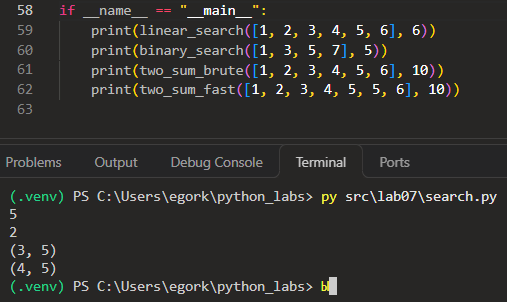
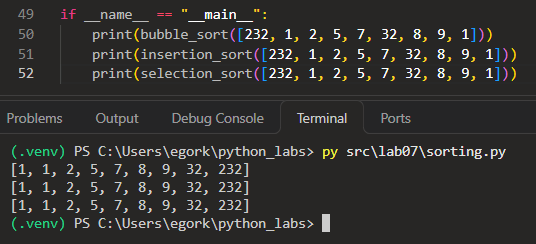
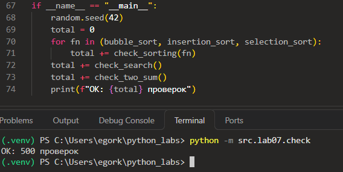
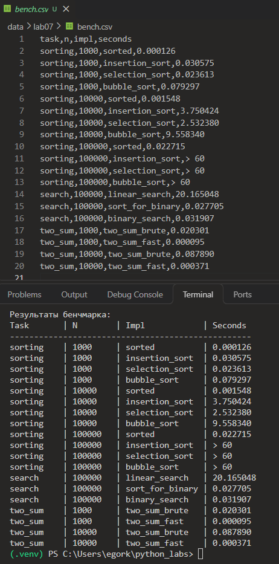

# ЛР7 — Поиск, сортировка и измерение времени

---

## Модуль src/lab07/search.py

---

### Функция **linear_search(nums, x) -> int**

Просто идет по списку и возвращает индекс первого вхождения, иначе выдает -1

```python
def linear_search(nums, x):
    for i in range(len(nums)):
        if nums[i] == x:
            return i
    return -1
```

---

### Функция **binary_search(sorted_nums, x) -> int**

Бинарный поиск ищет элемент в половинках отсортированного списка, смотрим в середину: если x меньше - ищем в левой половине, больше - в правой. Каждый шаг отбрасывает половину.

```python
def binary_search(sorted_nums, x):
    lo = 0
    hi = len(sorted_nums) - 1
    while lo <= hi:
        mid = (lo+hi) // 2
        if sorted_nums[mid] == x:
            return mid
        elif sorted_nums[mid] < x:
            lo = mid + 1
        else:
            hi = mid - 1
    return -1
```

---

### Функция **two_sum_brute(nums, target) -> tuple[int, int] | None**

Эта функция перебирает пары, сумма элементов которых должна быть равна target

```python
def two_sum_brute(nums, target):
    for i in range(len(nums)):
        for j in range(i+1, len(nums)):
            if nums[i]+nums[j]==target and i<j:
                return i, j
    return None
```

---

### Функция **two_sum_fast(nums, target) -> tuple[int, int] | None**

Более быстрая версия прошлой функции, но она делает это за один проход, используя словарь.

```python
def two_sum_fast(nums, target):
    seen = {}
    for i, x in enumerate(nums):
        if target - x in seen:
            return (seen[target - x], i)
        seen[x] = i
    return None
```



---

## Модуль src/lab07/sorting.py

---

### Функция **bubble_sort(nums) -> list**

пузырёк — проходим по списку, меняем соседей местами, если они стоят не по порядку; за проход максимум «всплывает» в конец

```python
def bubble_sort(nums):
    copie = nums.copy()
    flag = False
    n = len(nums)
    while flag == False:
        c = 0
        for i in range(n-1):
            if copie[i] > copie[i+1]:
                c += 1
                copie[i], copie[i+1] = copie[i+1], copie[i]
        if c == 0:
            flag = True
    return copie
```

---

### Функция **insertion_sort(nums) -> list**

вставками — берём очередной элемент и сдвигаем его влево, пока он не встанет на место; на почти отсортированных данных почти линейна — и именно поэтому её кусок живёт внутри sorted

```python
def insertion_sort(nums):
    copie = nums.copy()
    for i in range(len(copie)-1):
        for j in range(i, -1, -1):
            if copie[j+1] < copie[j]:
                copie[j+1], copie[j] = copie[j], copie[j+1]
            else:
                break
    return copie
```

---

### Функция **selection_sort(nums) -> list**

выбором — находим минимум оставшейся части, ставим на место; n раз по n

```python
def selection_sort(nums):
    copie = nums.copy()
    n = len(copie)
    c = 0
    for i in range(c, n):
        mini = i
        for j in range(i+1, n):
            if copie[j] <= copie[mini]:
                mini = j
        copie[mini], copie[i] = copie[i], copie[mini]
        c+= 1
    return copie
```



---

## Модуль src/lab07/check.py

---

### Функция **check_sorting(fn, trials=100) -> None**

Сравнивает с эталоном на многих случайных данных: генерирует 100 списков разной длины, с повторами, с отрицательными, пустой и из одного элемента, и для каждого проверяет fn(nums) == sorted(nums).

```python
def check_sorting(fn, trials=100):
    for _ in range(trials):
        n = random.randint(0, 50)
        nums = [random.randint(-100, 100) for _ in range(n)]
        original = list(nums)
        result = fn(nums)
        assert result == sorted(nums), f"{fn.__name__} ошиблась на {nums}: {result}"
        assert nums == original, f"{fn.__name__} изменила исходный список"
    return trials
```

---

### Функция **check_search() -> None**

Сравнивает с эталоном на многих случайных данных: генерирует 100 списков разной длины, с повторами, с отрицательными, пустой и из одного элемента.

```python
def check_search(trials=100):
    for _ in range(trials):
        n = random.randint(0, 50)
        nums = [random.randint(-100, 100) for _ in range(n)]
        x = random.randint(-100, 100)

        try:
            expected_lin = nums.index(x)
        except ValueError:
            expected_lin = -1
        actual_lin = linear_search(nums, x)
        assert actual_lin == expected_lin, f"linear_search ошиблась для поиска {x} в {nums}: получено {actual_lin}, ожидалось {expected_lin}"

        sorted_nums = sorted(nums)
        try:
            expected_bin = sorted_nums.index(x)
        except ValueError:
            expected_bin = -1
        actual_bin = binary_search(sorted_nums, x)
        if expected_bin == -1:
            assert actual_bin == -1, f"binary_search не нашла элемент, которого нет: {x} в {sorted_nums}"
        else:
            assert actual_bin != -1 and sorted_nums[actual_bin] == x, f"binary_search вернула некорректный индекс {actual_bin} для {x} в {sorted_nums}"
    return trials
```

---

### Функция **check_two_sum(trials=100) -> None**

```python
def check_two_sum(trials = 100):
    for _ in range(trials):
        n = random.randint(2, 30)
        nums = [random.randint(-50, 50) for _ in range(n)]
        if random.random() > 0.3 and n >= 2:
            i, j = random.sample(range(n), 2)
            target = nums[i] + nums[j]
        else:
            target = random.randint(-200, 200)

        res_brute = two_sum_brute(nums, target)
        res_fast = two_sum_fast(nums, target)

        if res_brute is None:
            assert res_fast is None, f"two_sum_brute нашла None, а fast нашла {res_fast} для nums={nums}, target={target}"
        else:
            bi, bj = res_brute
            assert nums[bi] + nums[bj] == target, f"two_sum_brute вернула неверные индексы {res_brute}"
            assert res_fast is not None, f"two_sum_brute нашла пару, а fast вернула None"
            fi, fj = res_fast
            assert nums[fi] + nums[fj] == target, f"two_sum_fast вернула неверные индексы {res_fast}"
    return trials
```



---

## Модуль src/lab07/bench.py

---

### Функция **main() -> None**

```python
def main() -> None:
    random.seed(42)
    csv_rows: list[tuple[str, int, str, str]] = []
    
    sizes = [1_000, 10_000, 100_000]
    for n in sizes:
        data = [random.randint(-1_000_000, 1_000_000) for _ in range(n)]

        t = timeit.timeit(lambda: sorted(data), number=1)
        csv_rows.append(("sorting", n, "sorted", f"{t:.6f}"))

        for name, fn in [("insertion_sort", insertion_sort), ("selection_sort", selection_sort), ("bubble_sort", bubble_sort)]:
            if n <= 10_000:
                t = timeit.timeit(lambda: fn(data), number=1)
                csv_rows.append(("sorting", n, name, f"{t:.6f}"))
            else:
                csv_rows.append(("sorting", n, name, "> 60"))

    search_data_size = 100_000
    search_queries_count = 10_000
    search_list = [random.randint(-1_000_000, 1_000_000) for _ in range(search_data_size)]
    queries = [random.choice(search_list) for _ in range(search_queries_count)]
    
    t = timeit.timeit(lambda: [linear_search(search_list, q) for q in queries], number=1)
    csv_rows.append(("search", search_data_size, "linear_search", f"{t:.6f}"))

    t = timeit.timeit(lambda: sorted(search_list), number=1)
    csv_rows.append(("search", search_data_size, "sort_for_binary", f"{t:.6f}"))

    search_list = sorted([random.randint(-1_000_000, 1_000_000) for _ in range(search_data_size)])
    t = timeit.timeit(lambda: [binary_search(search_list, q) for q in queries], number=1)
    csv_rows.append(("search", search_data_size, "binary_search", f"{t:.6f}"))

    for n in [1_000, 10_000]:
        ts_data = [random.randint(-1_000_000, 1_000_000) for _ in range(n)]
        i, j = random.sample(range(n), 2)
        target = ts_data[i] + ts_data[j]

        t = timeit.timeit(lambda: two_sum_brute(ts_data, target), number=1)
        csv_rows.append(("two_sum", n, "two_sum_brute", f"{t:.6f}"))

        t = timeit.timeit(lambda: two_sum_fast(ts_data, target), number=1)
        csv_rows.append(("two_sum", n, "two_sum_fast", f"{t:.6f}"))

    header = ("task", "n", "impl", "seconds")
    write_csv(csv_rows, "data/lab07/bench.csv", header=header)

    print("Результаты бенчмарка:")
    print(f"{'Task':<10} | {'N':<8} | {'Impl':<15} | {'Seconds':<10}")
    print("-" * 50)
    for task, n, impl, seconds in csv_rows:
        print(f"{task:<10} | {n:<8} | {impl:<15} | {seconds:<10}")
```


